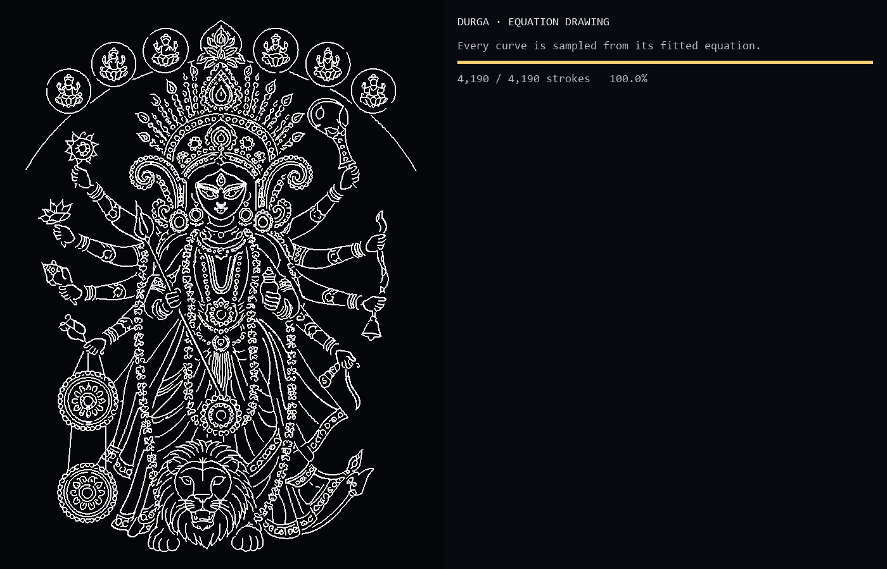

# Durga Equation Animation

**A live animation that turns Goddess Durga line art into thousands of fitted parametric curves.** Each stroke is traced from the reference, fitted to a line, circle, ellipse, or cubic Bezier chain, then drawn in a Pygame window alongside its equation.



## Demo

[Watch the animation recording](assets/demo.mp4) (MP4, included in this repository).

## Highlights

- Extracts and fits **4,190 strokes** from the supplied reference image.
- Draws in region order, from the halo and crown through the face, arms, garlands, lion, and mandalas.
- Shows fitted equations beside the live drawing; the Tier A equation appears 0.25 seconds before its stroke.
- Uses a glowing pen tip and a short gold ink trail against a dark, gridded canvas.
- Waits for SPACE before playback so screen recording can be started first.
- Builds cached geometry once and reuses it on later runs.
- Includes a headless selftest that writes a final frame, reference diff, and 12-frame contact sheet.

## Quick start

Requires Python 3.10 or newer. In Windows Command Prompt:

```cmd
cd /d C:\path\to\durga-equation-animation
py -3 -m venv .venv
.venv\Scripts\activate.bat
python -m pip install -r requirements.txt
python main.py
```

The first run preprocesses `assets/reference.png` and builds the cached strokes. Later runs load the cache. The window waits for **SPACE**, shows a three-second countdown, then begins. Nothing is exported as a video; record the window with your screen recorder.

## Usage

```text
python main.py [options]
```

| Option | Purpose |
| --- | --- |
| `--image PATH` | Use another reference image; default is `assets/reference.png`. |
| `--duration SECONDS` | Set target drawing time; default is 75 seconds. A duration too short for every equation lead-in is extended automatically. |
| `--layout side or stacked` | Choose landscape side panel or portrait stacked panel. |
| `--fullscreen` | Start fullscreen. |
| `--scale FACTOR` | Adjust the art size. |
| `--loop` | Restart after the finished-image hold. |
| `--rebuild` | Reprocess the image and replace cached geometry. |
| `--region halo,crown` | Play only the listed regions. |
| `--selftest` | Run the deterministic headless verification and save images under `shots/`. |

### Controls

| Key | Action |
| --- | --- |
| SPACE | Start, pause, or resume |
| R | Restart and return to the pre-recording screen |
| `+` / `-` | Adjust playback speed |
| F | Toggle fullscreen |
| S | Save a screenshot to `shots/` |
| H | Hide or show the equation panel |
| ESC / Q | Quit |

## How it works

1. **Preprocess:** Otsu thresholding, small-component cleanup, and skeletonization. The solid face component is handled as a contour to avoid a medial-axis artifact.
2. **Trace:** Convert the skeleton to ordered polylines, preserving loops and branches.
3. **Fit:** Choose a line, circle, ellipse, or cubic Bezier chain. Curves are sampled from the fitted equation for playback.
4. **Order:** Assign normalized image regions and order strokes by region, size tier, and nearest endpoint.
5. **Schedule:** Place long strokes individually, batch medium strokes, and reveal tiny details in regional bursts.
6. **Play:** Draw new curve segments onto a persistent surface using elapsed-time timing.

## Project layout

```text
assets/
  demo.mp4
  preview.png
  reference.png
src/durga_lineart/
  fit.py
  main.py
  order.py
  play.py
  prep.py
  regions.py
  timeline.py
  trace.py
main.py                 # convenient repository entry point
LICENSE
NOTES.md
pyproject.toml
requirements.txt
```

Generated cache files and screen captures are ignored by Git. Run `python main.py --selftest` to regenerate verification images locally.

## Verification snapshot

The current reference build contains 4,190 fitted strokes (202 Tier A, 858 Tier B, 3,130 Tier C). The measured maximum sampled fit deviation is 1.199 px. The headless selftest averaged 4.59 ms per frame in the latest run. See [NOTES.md](NOTES.md) for detailed measurements and recording tips.

## License and image rights

The project source code is licensed under the MIT License; see [LICENSE](LICENSE). The reference and preview images are included as project assets and may have separate attribution or redistribution terms. Confirm the reference image’s usage rights before redistributing it publicly.
